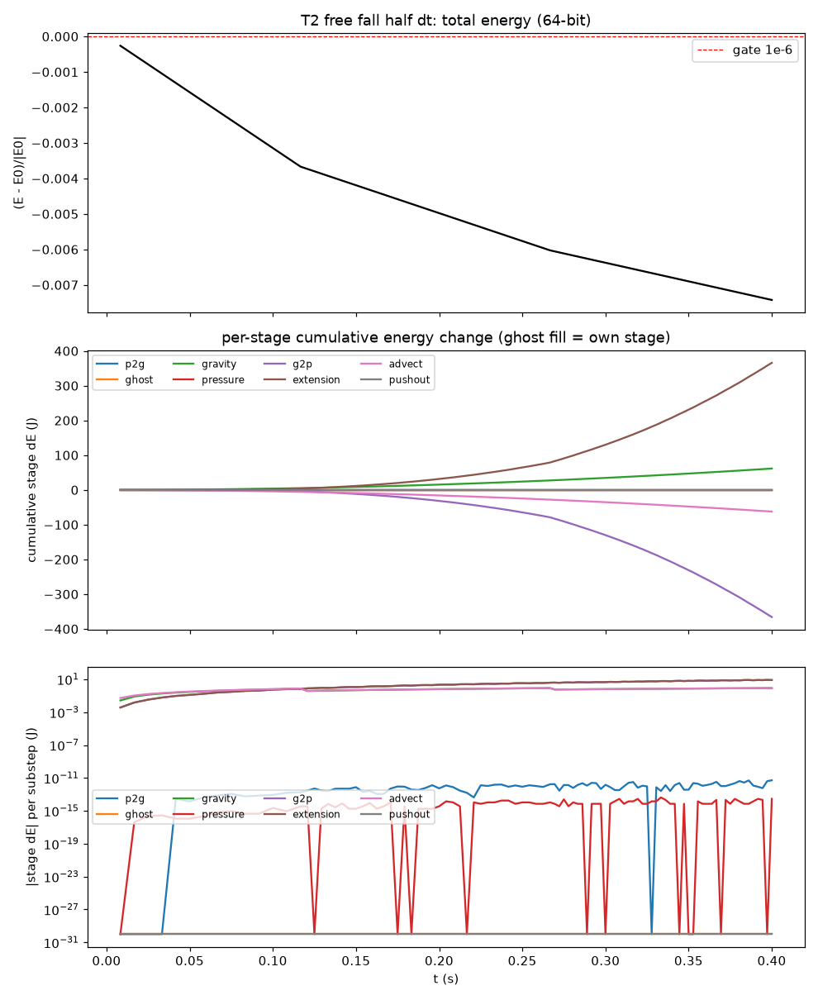
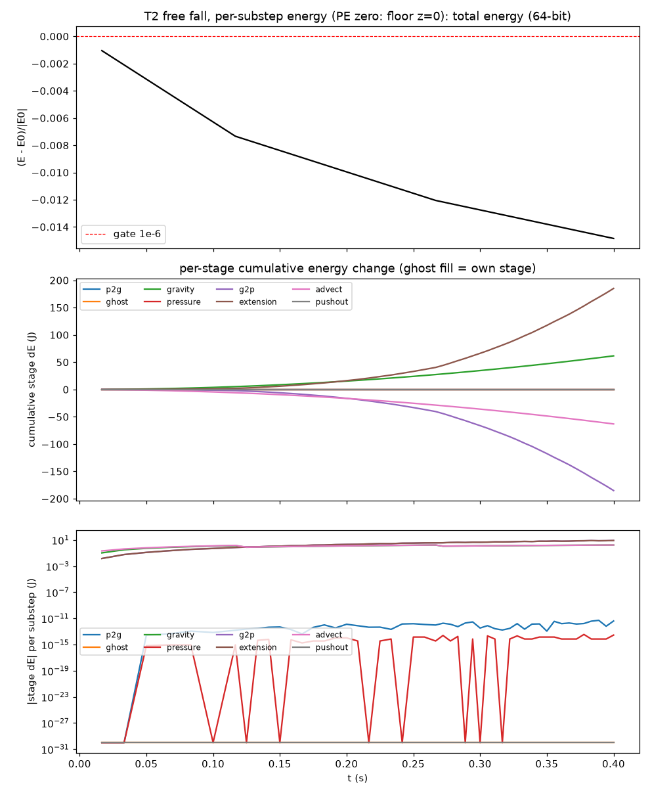
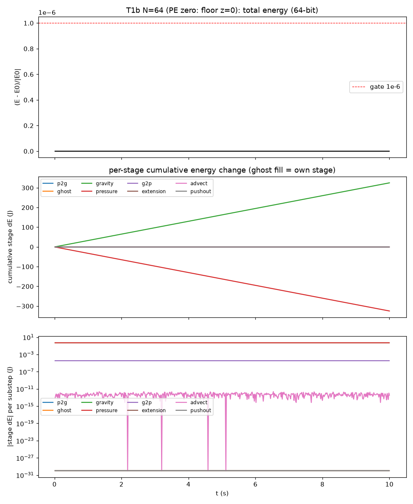
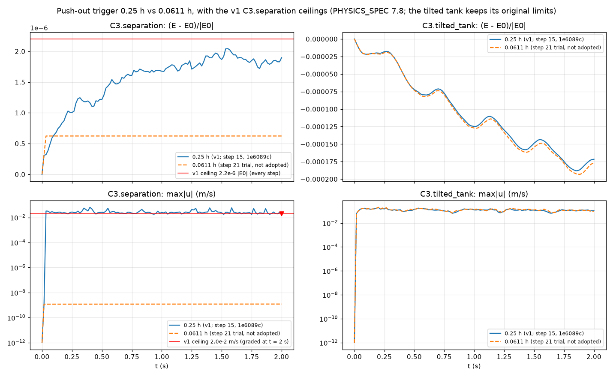

# Fluid Lab 3D devlog

Notes trail for a tutorial video: one entry per milestone, covering what we built, why, the key equation in plain words, what broke and how we fixed it, and a plot.

## Entry 0: Background from the 2D sim

_To be written: the 2D FLIP/APIC recap, the thin-ghost-cell energy blowup, and the push-out fixes._

## Exact solutions (Algebra/Equations Expert)

## Exact solutions: how we know the pressure solver is right (Algebra/Equations Expert)

**Why bother?** The pressure solve is the heart of every step. If it is wrong, the fluid still moves, so bugs hide. We test it on problems where we already know the answer.

**The trick: pick the answer first.** Choose a pressure field p you like, compute its Laplacian by hand, feed that in as the right-hand side, and see if the solver hands p back. Products of sines and cosines are ideal, because the Laplacian of each one is just a number times itself:
  lap[ cos(l pi x) cos(m pi y) cos(n pi z) ] = -pi^2 (l^2 + m^2 + n^2) * (same thing)

**Matching the boundaries.** The trig function is chosen to obey the same edge rules as the sim:
- Walls and floor: no flow through them, so the slope of p is zero there -> cosines (flat at the edges).
- Free surface on top: p = 0 -> cos((2n-1) pi z / 2), which is flat at the floor and zero at the top.

**The neat part.** On our grid these modes are *exact* answers of the discrete equations too, with eigenvalue
  lambda_h = -sum over axes of (4/h^2) sin^2(k h / 2).
So the solver must match to its own tolerance, not just "roughly". A boundary bug shows up as a big, obvious miss.

**One-face test.** Pressure zero on five faces, a bump x(1-x)y(1-y) on the floor. The answer is the 3D version of the classic rectangle problem: a double sine series across the floor times a sinh that dies off toward the top. Good for catching mistakes on a single face.

## SPH vs FLIP (Physics Expert)

## SPH vs FLIP: two ways to simulate a liquid with particles (Physics Expert)

**The shared idea.** Both methods carry the fluid on particles, because particles follow the liquid wherever it splashes and never smear the surface. They differ in how they answer one question: what is the pressure, and how does it push the particles?

**SPH (smoothed particle hydrodynamics): particles talk to particles.**
Any quantity at a point is a weighted average over nearby particles:
A(r) = Σ_j (m_j/ρ_j) A_j W(|r − r_j|, h)
- m_j/ρ_j is the volume particle j stands for, so the sum is an integral written as a sum over volumes.
- W is a smoothing kernel. It depends only on the distance |r − r_j| and is zero beyond the radius h. It integrates to 1, which is where the constant 315/(64πh⁹) in the poly6 kernel comes from. In 2D that constant becomes 4/(πh⁸).
- The steps are: compute each particle's density; turn density into pressure with an equation of state, such as p = k(ρ − ρ₀); then push particles apart along pressure differences, using a "spiky" kernel so close pairs still repel.
- **The catch:** a liquid barely compresses. With an equation of state, SPH only keeps it close to incompressible, and making k stiff forces tiny time steps. Without that, the water looks bouncy.

**FLIP/APIC (what Fluid Lab 3D uses): particles talk to a grid.**
1. Particles hand their velocities to a background grid. This step also uses smoothing weights, but they're short-range grid weights, not particle-to-particle sums.
2. On the grid we add gravity and solve one equation for the pressure that makes the flow exactly divergence-free: whatever flows into each cell flows out.
3. Particles read back the corrected velocity and move.
- **Why we chose it:** incompressibility is enforced exactly every step by a linear solve, rather than approximately through a stiff spring. That lets us check the result against exact answers, such as hydrostatic pressure p = ρg(H − z) and sloshing frequency ω² = gk·tanh(kH).
- **The cost:** a pressure solve every step, and care at walls and the free surface. Most of the bugs in our 2D sim, the ghost-cell blowup and the push-out fixes, lived there.

**One-line summary for the video.** SPH asks each particle's neighbours what the pressure is. FLIP asks a grid to make the water exactly incompressible, then tells the particles.

## Gate 1, first run (2026-10-13)

# Step 1 gate: devlog notes (Coding Expert, 2026-10-13)

What got built: Fluid Lab 3D v1 runs on the CPU in plain Node JavaScript under `src/`. It has a 3D MAC grid with one padding layer and a 2D-style ghost-face fold at the walls. Transfers are APIC with the quadratic B-spline. There is a mass-weighted ghost fill for faces whose m_f is below 5% of a full face mass. Gravity and the pressure-face coefficients both go through one rule in `src/facemass.js`: `carriesFluid(m_f) = m_f > 0`, which gives unit density on every fluid-carrying face. Pressure is solved with PCG and MIC(0) in 64-bit, at 1e-8 relative to ||rhs||, and every solve logs its iteration count and true residual. Walls get u·n = 0 (Neumann). The free surface is p = 0 through ghost fluid, with theta = (cell fill fraction) − ½, so a full top cell puts the surface exactly on the top face (p_ghost = −p, the family C setup). Advection is RK2. Push-out is a wall clamp that strips only the into-wall velocity, plus a pairwise separation push that is equal and opposite and clipped per axis. Substeps follow dt = h/(u_max + √(gh)) with up to 8 per 1/60 s frame. Energy is budgeted per stage: P2G, ghost, gravity, pressure, G2P, advect and push-out.

Gate results: pressure families A, B and C match their discrete eigenvectors to about 3e-13 when solved at 1e-12. Family D is second order at 3 of its 4 points. At (0.5, 0.5, 0.5) the first refinement gives order 1.71: the error is about 50× smaller there than at the other points and changes sign near N ≈ 10, so the coarse grids are pre-asymptotic. That row is a FAIL and was not loosened. T1 (still pool, 10 s at h/H = 1/8, 1/16, 1/32) and T2 (free fall: a = g to 1e-14, P_x and P_y at roundoff) pass every gate except the T1 force-order rows. With the unit-density face rule and theta = ½, the hydrostatic state is an exact discrete equilibrium. The force error is therefore about 1e-12 at every resolution, so the fitted "order" (0.44 to 0.50) is fitting roundoff. Those two rows are a FAIL by the letter of the gate and need a ruling from Validation.

What broke and the fixes:
- The 2D density-clamped face scale rho0/max(rho_f, 0.1·rho0) makes hydrostatics depend on particle jitter. It was dropped in favour of the single m_f > 0 rule.
- Air–air faces reached by the quadratic stencil would carry unprojected gravity into G2P. Valid velocities are now extrapolated 2 layers out after every projection.
- Padding nodes outside the box would bias G2P weights. P2G folds their mass onto the image face, and G2P reads tangential copies and a zero normal velocity there.
- T2 iteration counts: the first solve has an exactly zero rhs (0 iterations), and after that the rhs is at roundoff (13 iterations, constant). This is logged and is not a jump under the median-of-20 rule.

## Gate 1 closed (2026-10-14)

The Simulation Expert Lead closed Gate 1 on the amend run: **65/65 PASS, 0 flips** (`results/step3_gate1_amend`, code at 711cb19, ASSERTS md5 3b4821c8). Potential energy is measured from the floor, z = 0.

**Jacobi extension (spec section 7.4).** After each pressure solve we copy valid velocities a couple of layers out into the air, so the particle stencil never reads junk. Each layer reads only a snapshot taken before that layer, across all 26 neighbours. Nothing filled earlier in the same pass leaks into later cells. The step-2 code already worked this way, so this run only documents it. Every graded value is bit-identical.

**Where is the water surface? (T1b).** In ghost-fluid form the surface sits at z_c + θh, where θ is how full the top cell is, minus one half. That height equals the expected water depth H_eff exactly in every column at every resolution: 0.1640625 m at N = 8 and 16, and 0.162109375 m at N = 32 and 64.

**Why free fall loses a bit of energy (T2).** Halving the time step halves the energy drift at t = 0.4 s, from −1.4848e-2 to −7.4239e-3, a ratio of 0.5000. That is the signature of a first-order time-integration error from moving particles with the post-gravity velocity. It is not a leak in the particle–grid transfers.

## Steps 16-22: C3.separation diagnosis and the v1 freeze (2026-10-14)

- **Step 16, separation energy trace.**
  - What: we checked whether the +1.2e-3 J per-step pressure jumps came from cells flipping between fluid and air.
  - Result: no flips, and pressure dE was negative on every step in both weightings. The +1.2e-3 J is the ordinary gravity+pressure net, and G2P removes it again.
- **Step 17, jitter control.**
  - What: we reran C3.separation on an exact lattice (jitter 0) to see whether jitter matters.
  - Result: the lattice passes, at about 1e-13 |E0| and 1e-9 m/s. With jitter 0.5, the surface θ starts uniform at t=0 and spreads (std 0.03) after step 1.
- **Step 18, step 1-2 trace.**
  - What: we traced which stage first produces the max|u| jump.
  - Result: it comes from the step-2 pressure solve on top-row surface faces, at 8.13e-2 m/s.
  - Zeroing C changes nothing. Air-face extension is 8x smaller. The trigger is step-1 push-out pair separation (1327 particles cross cell lines, 54 of them at the surface), which changes the count-based θ.
- **Step 19, smooth θ trials.**
  - Splat θ (Phase A) failed the T1b lattice and flat-fill unit rows (bias up to 1.2e-1), so the room froze a column-volume θ.
  - Column-volume θ passed every unit row, and Gate 1 stayed 68/68 with 0 flips. The graded suite got worse:
    - C3.separation energy 7.1e-5 and max|u| 1.2e-1;
    - the tilted tank regressed;
    - T4 a=8 rose to 3.12%;
    - 22-49% of surface cells fell back to count θ.
  - Ruling: not adopted. thetaMode defaults to 'count', and colvol stays behind the flag.
- **Step 20, revert and seed statistics.**
  - The revert is bit-identical to 1e6089c.
  - At t=0 on the frozen separation seed, 22.4% of particles sit closer to a neighbour than the 0.25 h trigger. The 0.1% quantile of that spacing is 0.0611 h.
- **Step 21, trigger 0.0611 h trial.**
  - The full Gate 1 at b29c99e is bit-identical to 1e6089c.
  - With the 0.0611 h trigger, C3.separation passes (6.2e-7 |E0|, 1.2e-9 m/s), but T4 rises to 3.32% (a=16) and 5.08% (a=8).
  - The trade-off: the trigger does real anti-clumping work in the dam break.
  - Ruling: not adopted.
  - Snapshots of the v1 dam break: [docs/snapshots/step21_T3_a16/](snapshots/step21_T3_a16/README.md).
- **Step 22, v1 freeze.**
  - The trigger is back at 0.25 h (sepTrig kept as a parameter). The full Gate 1 is bit-identical to 1e6089c.
  - T4 and C3.separation are v1 known limitations with graded regression ceilings (PHYSICS_SPEC 7.8): T4 2.60% / 2.70%; C3.separation 2.2e-6 |E0| and 2.0e-2 m/s at 2 s. v1 measures 2.46% / 2.59% and 2.04e-6 / 1.79e-2.

